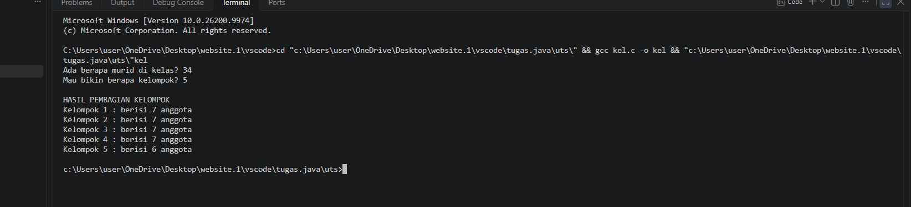

# Team Maker

Project Ujian Tengah Semester (UTS) mata pelajaran Pemrograman Dasar / Koding & Kecerdasan Artifisial kelas X PPLG. Aplikasi ini dibuat dalam dua versi bahasa pemrograman, yaitu **C** dan **Python**.

## Identitas Siswa
* **Nama Lengkap:** [Azhrul Hidayat]
* **Kelas:** X PPLG
* **No. Absen:** [7]

## Deskripsi Aplikasi
Fungsi Utama
Aplikasi ini berfungsi untuk membagi sejumlah murid ke dalam beberapa kelompok secara merata berdasarkan total murid dan jumlah kelompok yang diinginkan, sekaligus mendistribusikan sisa murid secara adil ke kelompok-kelompok awal menggunakan operator aritmatika (pembagian dan modulo %).
Fitur Utama Aplikasi
Input Jumlah Murid & Kelompok: Meminta pengguna memasukkan total murid di kelas dan jumlah kelompok yang ingin dibentuk.
Perhitungan Pembagian & Sisa Otomatis: Menghitung jumlah anggota dasar per kelompok (/ di C atau // di Python) serta sisa murid yang tidak terbagi rata (%).
Distribusi Sisa Murid Merata: Menambahkan 1 anggota ekstra ke kelompok berurutan (1 hingga sisa_murid) agar selisih jumlah anggota antar kelompok maksimal hanya 1 orang.
Tampilan Hasil Pembagian: Menampilkan daftar nomor kelompok beserta jumlah anggota masing-masing secara rapi di layar.

## Daftar File
* `kel.c` : Kode program utama menggunakan bahasa C.
* `kel.py` : Kode program utama menggunakan bahasa Python.
* `output-program.png` : Screenshot hasil menjalankan program aplikasi.

## Screenshot Output Program

